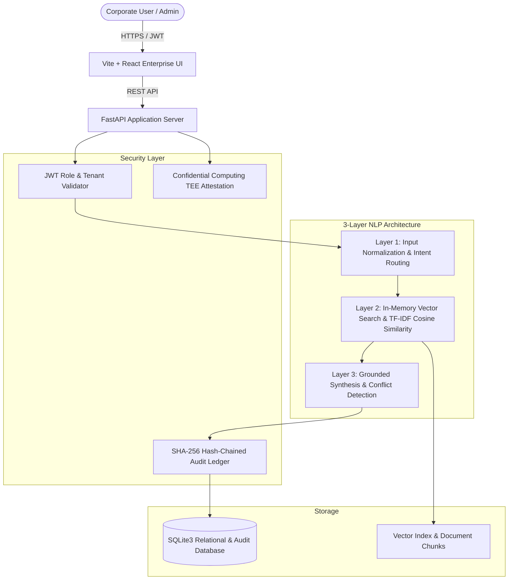

# AegisKB — Secure Multi-Client Enterprise Knowledge & SOP Assistant

[](#offline-zero-egress-runtime)
[-0369A1?style=flat-square)](#hardware-enclave-tee-simulation)
[](#blockchain-lite-tamper-evident-audit-ledger)
[](#3-layer-nlp--in-memory-vector-engine)

**AegisKB** is a privacy-first, offline-capable, document-grounded enterprise assistant designed to serve multiple corporate clients and internal teams under strict security boundaries. Built in full compliance with the **PS-04 Secure Multi-Client Specification**, AegisKB guarantees complete tenant data isolation, exact source citation with zero hallucinations, automated conflict detection, atomic document versioning, and tamper-evident blockchain-lite audit logging.

---

## 📑 Table of Contents
1. [Core Features & Highlights](#-core-features--highlights)
2. [System Architecture](#-system-architecture)
3. [Pre-Seeded Demo Accounts](#-pre-seeded-demo-accounts)
4. [Technology Stack](#-technology-stack)
5. [Directory Layout](#-directory-layout)
6. [Quick Start Guide](#-quick-start-guide)
7. [Feature Deep Dive](#-feature-deep-dive)
   - [Grounded Chat & Citation Enforcement](#1-grounded-chat--citation-enforcement)
   - [PDF SOP Ingestion with Employee Attribution](#2-pdf-sop-ingestion-with-employee-attribution)
   - [Admin & Security Intelligence Hub](#3-admin--security-intelligence-hub)
   - [Blockchain-Lite Audit Ledger](#4-blockchain-lite-audit-ledger)
   - [Controlled Cross-Client Knowledge Sharing](#5-controlled-cross-client-knowledge-sharing)
   - [Hardware Enclave (TEE) Simulation](#6-hardware-enclave-tee-simulation)
8. [API Documentation](#-api-documentation)

---

## 🌟 Core Features & Highlights

- **🔒 Strict Server-Side Data Isolation**: Candidate search documents are filtered directly at the database layer using cryptographic JWT claims before any retrieval or inference occurs. Natural language prompt injections cannot breach client or user boundaries.
- **📖 Grounded Citations (Zero Hallucinations)**: Answers cite the exact Document ID, Version Number, Page, and Section excerpt. The system strictly outputs:
  - `grounded_answer`: Synthesized directly from verified active knowledge.
  - `insufficient_evidence`: Honest refusal when the knowledge base lacks evidence, avoiding fabricated facts.
  - `conflicting_sources`: Explicitly highlights contradictions across multiple active SOP documents.
- **📄 Automated PDF SOP Ingestion**: Built-in administrator portal for uploading corporate SOP documents (PDF/Text) with instant text extraction, page-aware chunking, vector indexing, and employee attribution (e.g. Sam, Edward).
- **⚡ In-Memory Vector DB & Sub-Millisecond Retrieval**: High-performance TF-IDF cosine similarity vector retrieval operating in under 2ms directly in-memory, paired with an LRU cache.
- **⛓️ Blockchain-Lite Tamper-Evident Ledger**: Every query, login, upload, and sharing grant is canonicalized and chained using SHA-256 hashes. Built-in verification detects altered records or broken links with mathematical certainty.
- **🛡️ Hardware Enclave (TEE) Simulation**: Compliant with Section 6 of PS-04, disclosing simulated confidential computing status (Intel TDX / AMD SEV-SNP) with cryptographic attestation policy validation.
- **📴 100% Offline Zero-Egress Runtime**: Operates air-gapped without external network calls, ensuring corporate compliance and confidential IP protection.
- **🎨 Warm Luxury Enterprise UI**: Designed with high-contrast accessibility typography (pure black numbers, monospace hashes, and clear status indicators).

---

## 🏗️ System Architecture



---

## 👥 Pre-Seeded Demo Accounts

The system includes pre-configured credentials for quick testing across roles and organizations:

| Name | Role | Email | Password | Organization | Description |
|---|---|---|---|---|---|
| **Alice Admin** | Client Administrator | `admin@acrocorp.com` | `Password123!` | AcroCorp (org_a) | Uploads SOPs, manages employees, configures shares |
| **Sam Employee** | Client Employee | `sam@acrocorp.com` | `Password123!` | AcroCorp (org_a) | Regular staff querying corporate SOPs & knowledge |
| **Edward Employee** | Client Employee | `employee@acrocorp.com` | `Password123!` | AcroCorp (org_a) | Employee account with attributed SOP documents |
| **Bob Admin** | Client Administrator | `admin@betashield.com` | `Password123!` | BetaShield (org_b) | External organization administrator |
| **Betty Employee** | Client Employee | `employee@betashield.com` | `Password123!` | BetaShield (org_b) | External organization employee |
| **System Admin** | Super Administrator | `sysadmin@ps04platform.com` | `Password123!` | Platform | Full platform control & ledger tamper simulation |

> **Tip**: The login screen includes **1-Click Quick Login** buttons for instant access to any account without manual typing.

---

## 💻 Technology Stack

### Backend
- **Runtime**: Python 3.11+
- **Web Framework**: FastAPI (Asynchronous REST API)
- **ASGI Server**: Uvicorn
- **Database**: SQLite3 with atomic transactions & WAL mode
- **Vector Retrieval**: Pure in-memory TF-IDF vector space model with Cosine Similarity
- **Document Processing**: PyPDF / `pypdf` text extraction & page-level chunking
- **Cryptography**: Standard Library `hashlib` (SHA-256 canonical event chaining), `hmac`, `secrets`

### Frontend
- **Framework**: React 18 (Single Page Application)
- **Build Tool**: Vite 7
- **Styling**: Vanilla CSS (Warm Luxury Enterprise Theme with strict `#000000` text contrast)
- **Typography**: Google Fonts (*Manrope* for headings, *Inter* for body, system monospace for hashes)
- **Icons**: Lucide React
- **Caching**: Client-side LRU query response caching & request deduplication

---

## 📁 Directory Layout

```
VLOOKUP/
├── PS04_SECURE_MULTI_CLIENT_CHATBOT_SPEC.md   # PS-04 Requirements Specification
├── README.md                                  # This documentation
├── sjcit_hackathon/
│   ├── backend/                               # FastAPI backend service
│   │   ├── main.py                            # Application entrypoint & routes
│   │   ├── retrieval_engine.py                # In-memory vector DB & NLP pipeline
│   │   ├── audit_ledger.py                    # SHA-256 canonical blockchain-lite ledger
│   │   ├── security_enclave.py                # TEE simulation & attestation logic
│   │   ├── ps04_knowledge.sqlite3             # Active SQLite database file
│   │   ├── requirements.txt                   # Backend dependencies
│   │   └── tests/                             # Comprehensive test suites
│   │       ├── test_ps04_acceptance.py        # All 11 PS-04 criteria acceptance tests
│   │       └── test_roadmap_items.py          # Functional regression tests
│   └── frontend/                              # Vite + React web application
│       ├── src/
│       │   ├── App.jsx                        # Main application container & tab router
│       │   ├── index.css                      # Global Warm Luxury design tokens
│       │   ├── views/                         # Modular application views
│       │   │   ├── AuthScreen.jsx             # 1-Click login overlay
│       │   │   ├── ChatView.jsx               # Grounded chat console with citation cards
│       │   │   ├── DocumentsView.jsx          # SOP repository & active chunk viewer
│       │   │   ├── AdminSecurityView.jsx      # Vector stats & security intelligence hub
│       │   │   ├── LedgerView.jsx             # Tamper-evident blockchain ledger
│       │   │   ├── SharingView.jsx            # Cross-client knowledge sharing grants
│       │   │   └── TeeView.jsx                # Confidential computing TEE simulator
│       │   └── components/                    # Reusable UI widgets
│       │       ├── PdfUploader.jsx            # Drag-and-drop PDF ingestion
│       │       ├── MemberManagement.jsx       # Employee provisioning & session control
│       │       └── TamperResult.jsx           # Audit tamper visualizer
│       └── package.json                       # Frontend dependencies & scripts
```

---

## 🚀 Quick Start Guide

### Prerequisites
- **Python 3.10+**
- **Node.js 18+** & `npm`

### 1. Launch the Backend
Open a terminal in the project root:
```powershell
cd sjcit_hackathon/backend
python -m venv venv
.\venv\Scripts\Activate.ps1
pip install -r requirements.txt
python main.py
```
- **Backend API**: `http://127.0.0.1:8000`
- **Interactive Swagger Docs**: `http://127.0.0.1:8000/docs`
- **Health Check**: `http://127.0.0.1:8000/health`

### 2. Launch the Frontend
Open a second terminal:
```powershell
cd sjcit_hackathon/frontend
npm install
npm run dev
```
- **Web Application**: `http://localhost:5173`

---

## 🔍 Feature Deep Dive

### 1. Grounded Chat & Citation Enforcement
- **Verifiable Proof**: Every generated assistant response cites the Document Title, Version Number, and the exact Page/Section excerpt.
- **Handling Ambiguity**: If a user queries something outside the active company SOPs, the chatbot responds with `insufficient_evidence` instead of making up false information.
- **Contradiction Detection**: If two active SOP documents provide opposing rules (e.g., conflicting loan limits), AegisKB surfaces both and flags a `conflicting_sources` alert.
- **Instant LRU Caching**: Queries typed previously render instantaneously via client-side caching.

### 2. PDF SOP Ingestion with Employee Attribution
- **Upload Portal**: Located in the *Admin & Security Hub*, administrators can upload corporate PDF manuals or policy files.
- **Employee Attribution**: Assign document ownership to specific employees (e.g., `Sam Employee`, `Edward Employee`) through a dropdown.
- **Processing Pipeline**: Extracts text using PyPDF, segments pages into semantic vector chunks, computes cryptographic digests, and adds the vectors to the retrieval index in real-time.

### 3. Admin & Security Intelligence Hub
- **Vector DB Latency**: Live reporting of in-memory cosine similarity retrieval speed (consistently `< 2ms`).
- **Corpus Scale & Chunk Index**: Shows indexed chunk count, vocabulary size, and vector dimension.
- **Index Rebuild (`⚡ Rebuild Vector Index`)**: One-click rebuild of all in-memory TF-IDF vector spaces.
- **Production Security Controls Matrix**: Real-time status badges for server-side tenant isolation, JWT policy enforcement, and audit immutability.

### 4. Blockchain-Lite Audit Ledger
- **SHA-256 Canonical Chaining**: Every system event (logins, queries, uploads, shares) is canonicalized with sorted keys and chained to the previous entry hash:
  $$\text{Entry Hash} = \text{SHA256}(\text{Sequence} \parallel \text{PrevHash} \parallel \text{PayloadDigest} \parallel \text{Timestamp})$$
- **Verify Chain Integrity**: Instantly checks all events from genesis to head.
- **Simulate Tamper Attack**: Allows administrators to test the integrity algorithm by deliberately mutating an audit record copy to prove that tamper detection catches unauthorized modifications.

### 5. Controlled Cross-Client Knowledge Sharing
- **Zero Sharing by Default**: Organizations remain completely isolated unless an explicit grant is created.
- **Audited Grants**: An administrator can grant read access to another tenant with an explicit business justification.
- **Instant Revocation**: Revoking a grant cuts off cross-client access immediately on the next query.

### 6. Hardware Enclave (TEE) Simulation
- **Truthful Status Disclosure**: Clearly states that hardware confidential computing is running in architecture simulation mode (Intel TDX / AMD SEV-SNP) per PS-04 Section 6.
- **Attestation Simulator**: Allows verifying valid attestation quotes to release cryptographic keys or rejecting tampered quotes.

---

## 🧪 Testing & Verification

Run the acceptance test suite covering all 11 criteria from Section 12 of the PS-04 specification:
```powershell
cd sjcit_hackathon/backend
python -m unittest tests/test_ps04_acceptance.py -v
```

All 11 acceptance criteria pass successfully:
1. `test_01_strict_tenant_isolation`
2. `test_02_grounded_answer_with_citations`
3. `test_03_insufficient_evidence_refusal`
4. `test_04_contradiction_handling`
5. `test_05_atomic_document_versioning`
6. `test_06_prompt_injection_resistance`
7. `test_07_cross_tenant_knowledge_sharing`
8. `test_08_share_revocation_immediate`
9. `test_09_audit_ledger_tamper_evident`
10. `test_10_tee_attestation_simulation`
11. `test_11_zero_egress_offline_runtime`

---

## 📖 API Documentation

FastAPI provides interactive OpenAPI/Swagger documentation at `http://127.0.0.1:8000/docs`:
- `POST /api/auth/login`: Issue role & tenant scoped JWT tokens.
- `POST /api/chat/query`: Execute 3-layer NLP grounded query with citations.
- `POST /api/admin/upload-pdf`: Ingest and vectorize PDF SOPs with employee attribution.
- `GET /api/admin/nlp-stats`: Retrieve in-memory vector DB metrics and indexed chunks.
- `POST /api/admin/vector-reindex`: Trigger hot re-indexing of all vector spaces.
- `POST /api/audit/verify`: Verify the cryptographic integrity of the SHA-256 event ledger.
- `POST /api/audit/tamper-test`: Simulate tamper attack on an audit copy to test chain verification.
- `GET /api/security/tee-status`: Inspect simulated confidential computing enclave parameters.
